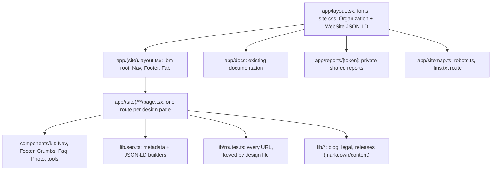

# Busiman marketing site: architecture

Rebuild of the `landing` site from the approved design (Design artifact, 79 pages). Next.js 16 App Router, React 19, TypeScript, Tailwind 4 installed, hosted as before.

## 1. Requirements

**Functional.** 79 indexable pages (sitemap in the design), shared sticky nav, footer, fixed contact buttons, working free tools (GST, quotation, overtime, late fee, barcode, invoice, salary slip, attendance sheet), glossary search, site search. Existing live features stay: docs (`/docs`), blog from markdown, privacy, terms, delete-account, private shared reports (`/reports/[token]`), changelog data (`lib/releases.ts`).

**Non-functional.** Server-rendered HTML readable without JavaScript (SEO and AI crawlers). Responsive at 390, 820 and 1440. WCAG AA contrast, visible keyboard focus, reduced motion respected. No claim that is not verified (no prices, counts, certifications, speed or legal statements). Phone `7500673358`, email `team@busiman.org`, `www.busiman.org` everywhere identical.

**Constraints.** No backend for forms (see ADR-4). Stock photos are placeholders for launch.

## 2. Architecture

## 3. Decisions

**ADR-1: Replace in place, keep the live features.** Status: accepted (owner's choice). The marketing pages, chrome and design system are replaced. Docs, reports, blog data, legal data, releases and delete-account are kept and restyled, because they are product features and registered URLs (store listings link to `/privacy-policy` and `/delete-account`). Git history is the rollback. Trade-off: one deploy unit instead of two; risk is limited by keeping those routes unchanged.

**ADR-2: Port the QA-verified design stylesheet instead of re-expressing it in Tailwind utilities.** Status: accepted. `app/site.css` (from the design) is the single design system under a `.bm` root. Pages use its class names; page-specific rules live in a CSS Module next to the page. Alternatives: Tailwind utilities everywhere (visual drift from the approved design, slower, 79 pages to re-verify) or CSS-in-JS (runtime cost). Trade-off: global classes need discipline; mitigated by the `.bm` scope and one component kit.

**ADR-3: Server components by default; client components only for interaction.** Status: accepted. Tools, glossary search, site search and the mobile menu are the only `"use client"` files. Everything else ships as static HTML. Alternative: SPA-style client rendering, rejected because AI crawlers often do not run JavaScript.

**ADR-4: No invented endpoints.** Status: accepted. Contact, demo, login and signup have no backend in this repo. Forms degrade to `mailto:` and links to the real apps. No page pretends to submit data. Revisit when an API exists.

**ADR-5: One routing table.** Status: accepted. `lib/routes.ts` maps each design page to its URL. The live URL `/features/field-service-management` is kept (not renamed to `service-management`) for SEO continuity. Privacy lives at `/privacy-policy`.

**ADR-6: Structured data per page type, generated from the same strings shown on the page.** Status: accepted. FAQPage text equals the visible answer; no ratings, prices or review counts.

## 4. Risks and mitigations

| Risk | Mitigation |
|---|---|
| Visual drift from the approved design | Same stylesheet, same class names; review agents compare rendered pages to the artifact at 3 widths |
| Invisible-text and overflow bugs seen in the design QA | Same Playwright checks run against the built site |
| Retained pages (docs, reports) look off-brand | Restyle task with its own review |
| Forms look functional but are not | ADR-4: mailto only, listed in handoff |
