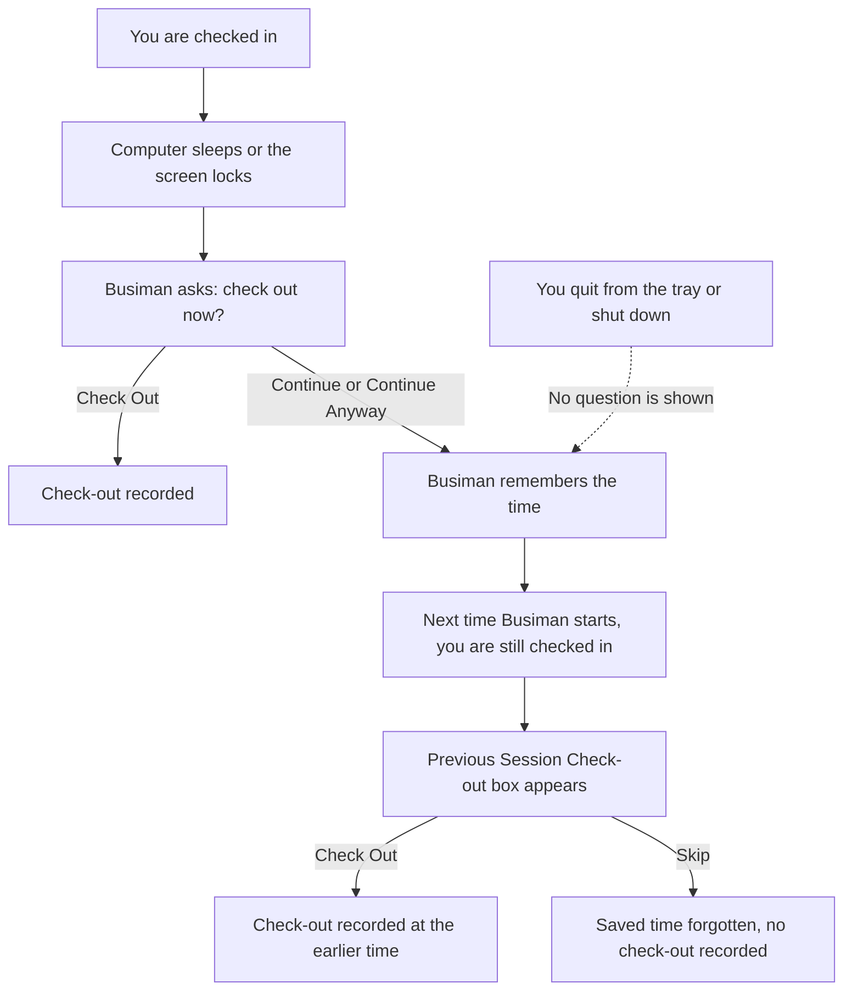

Busiman records when you start and end your workday. It does this in two ways: automatically in the background, and by hand for Employees. Your company can also limit check-in to approved office networks.

## How attendance works

- **Approved network.** HR or Admin keeps a list of office Wi-Fi networks and Ethernet connections that count as "at work". Busiman reads which network your computer is on and asks the server if it is approved.
- **Automatic check-in.** Busiman tries to check you in without you doing anything. It applies to every role, and the server decides whether it is allowed.
- **Manual check-in and check-out.** Only Employees have buttons for this, on the Employee Dashboard.
- **Automatic check-out prompts.** When your computer sleeps, locks or shuts down while you are checked in, Busiman asks whether you want to check out.

## Automatic check-in

Busiman tries to check you in when:

- you sign in,
- Busiman starts and you are already signed in,
- your computer wakes from sleep, and
- your computer joins a different network.

You can turn this off in **Settings > Attendance** (see [Settings](/docs/desktop-app/settings)). The switch there is named "Enable Auto Check-In on App Start", and it controls all of these triggers, not only the one at start-up.

### What you will see

You get an on-screen message in only two situations:

- **Success.** "Attendance Marked - You have been automatically checked in", with your Wi-Fi name (or "Office Wi-Fi" / "Office Network").
- **The server said no.** A "Check-In Failed" message with a plain reason, for example no shift, too early, too late, holiday, or not scheduled today. You may also see "Unable to mark attendance. Please try again or contact support."
- **The connection dropped during check-in.** You see "Network Error". This is not a refusal. Check your connection and try again.

If HR lets you check in without office Wi-Fi, automatic check-in skips the network check.

### When nothing appears

In many cases Busiman gives **no message at all**: auto check-in is switched off, you are not on an approved network, you are already checked in or out for today, the computer has no connection, or the server could not be reached before the check.

So no message does not mean you are checked in. To find out:

- **Employee:** open the Employee Dashboard and look at the badge in **My Attendance**. It reads Not Started, Checked In or Checked Out.
- **Admin, HR or Manager:** open **Attendance** > **Overview**, pick today's date and look for your own row (if you appear in the list). The Status column shows Checked In, Checked Out or Not Started. If you are not checked in and should be, ask your HR or Admin.

## Employee: check in and out by hand

Employees do this on the **Employee Dashboard**, in the **My Attendance** panel.

1. Open **Dashboard**.
2. Look at **Current Connection**. It shows "WiFi: (your network name)", "Ethernet: (MAC address) (adapter name)" (for example "Ethernet: 00-E0-4C-68-00-49 (Realtek USB)") or "Not connected". While it is checking, it shows "Checking...". Use the refresh button next to it if you just changed network.
3. A green message "Connected to approved WiFi/Ethernet network" means you can go on. A red message means your network is not approved.
4. Select **Check In**. When you are done for the day, select **Check Out**.

The panel also shows **Check-In Time**, **Check-Out Time** and **Total Duration**, and the badge **Not Started**, **Checked In** or **Checked Out**. Busiman re-checks your network when you return to the window and every 20 seconds.

While you are checked in, a hint at the bottom reminds you "You are currently checked in. Don't forget to check out at the end of your shift."

The buttons are greyed out when the server says you cannot check in or out right now, when the network is being checked, or when the network is not approved and you have no exception. If HR has allowed you to check in or out without Wi-Fi, the buttons work without the network check.

If something is wrong, the red message shows the reason, for example:

- "Network connection is not approved for attendance"
- "No network connection detected. Please connect to a WiFi or Ethernet network."
- "Network connection validation failed. Please check your connection."
- "Please wait for network validation to complete"

Other reasons (already checked in, no shift, holiday and similar) are shown exactly as the server sends them.

## Admin, HR and Manager: no manual check-in

There are no Check In or Check Out buttons for these roles in the desktop app. You are checked in only by the automatic check-in described above. If it did not work, ask the person who looks after attendance for your company.

## The Attendance screen

Open **Attendance** in the top bar. The tabs you see depend on your role.

| Role | Tabs you see |
|---|---|
| Admin | Overview, Approvals, Setup |
| HR | Overview, My attendance, Approvals, Setup |
| Manager | Overview, Approvals |
| Employee | My attendance (and Overview and Approvals only if made an Attendance Officer) |

Two tabs are not finished yet: **My attendance** only shows "Coming soon." and **Setup** only shows "Wi-Fi, devices, and shifts - coming soon." Manage Wi-Fi networks and shifts in **Settings** instead.

### Overview

A list of people's attendance for a day.

- Title: "Team Attendance" (managers), "Employee & Manager Attendance" (HR) or "Attendance Records" (Admin).
- Controls: a date picker, a search box, a department filter (not shown to managers) and a status filter: All statuses, Checked in, Checked out, Not started.
- Page sizes: 10, 25, 50 or 100 rows. The default is 25.
- Summary counts appear at the top.
- Some rows say "Pending check-in", "Pending check-out", "Checked in (pending)" or "Checked out (pending)". These are waiting for approval.
- Select a person's name to open their attendance history. Only HR, Admin and Manager can open this page.

### Export

Select **Export** to download a spreadsheet file (CSV) named like attendance_2026-10-14.csv. It contains **at most the first 100 rows** of what you filtered for the chosen date, not just the rows visible on the page. Narrow the filters if you need a specific set of people.

### Mark or clear attendance for someone else

Only Admin, HR and Attendance Officers can do this. **Managers cannot mark or clear attendance.**

Whether you can act on a particular person depends on rules set for that person. Admin can always. An Attendance Officer can act for the people assigned to them. HR can act unless that person has a specific allowed-list that does not include HR.

When you are allowed, the Status cell in a row becomes clickable and a small **x** appears.

**To mark attendance**

1. Select the person's Status.
2. The box "Mark Attendance for (name)" opens. Choose **Action**: Check In or Check Out.
3. Optionally set the **Check-in Time** or **Check-out Time**. Leave it empty to use the current time.
4. If you are not an Admin, the box also shows the **Network Status**. When the network check fails, you must fill in **Override Reason**. Network validation must pass or you must give a reason.
5. Select **Mark Check In** or **Mark Check Out**.

Note: when this box opens, Busiman automatically asks your computer for your location and sends it if available. There is no separate prompt inside Busiman.

**To clear attendance**

1. Select the **x** in the person's row.
2. Confirm: "Clear today's attendance for (name)? This resets them to Not Started and cannot be undone."

Clearing cannot be undone.

### Approvals

Where attendance requests that need a decision appear. Only Manager, HR and Admin can use this tab.

Columns: Employee (with department), Date, Action (Check-in or Check-out), Submitted, Note, and From (Home, Client site, Travel or other text).

- **Approve** accepts the request.
- **Reject** opens "Reject attendance" and requires a reason.
- **Refresh** reloads the list.
- If nothing is waiting, you see "No pending attendance requests."
- The list updates by itself. A small pulsing marker on the Approvals tab means something is waiting.

Attendance Officers who are Employees see an Approvals tab, but its panel is blank. They cannot decide requests in the desktop app.

## When you check out: sleep, lock and shut down

If you are checked in and your computer is about to sleep or the screen is about to lock, Busiman may show a box titled **Check Out** and asking "Are you checking out...?". The box waits until you answer.

| When | Message | Buttons |
|---|---|---|
| Computer is going to sleep | "Your system is trying to sleep. Would you like to check out before sleeping?" | **Check Out** / **Continue** |
| Screen is locking, or shutting down | "You are currently checked in. Would you like to check out before shutting down?" | **Check Out** / **Continue Anyway** |

- **Check Out** records your check-out.
- **Continue** or **Continue Anyway** does not check you out. Busiman remembers the time you slept, locked or shut down.

### The next time Busiman starts

If you chose **Continue** or **Continue Anyway**, or the computer shut down before you answered, and you are still checked in, Busiman shows **Previous Session Check-out**: "You closed the system at (date and time) without checking out. Would you like to check out now at that time?" The buttons are **Check Out** and **Skip**.

- **Check Out** records your check-out at that earlier time.
- **Skip** forgets the saved time. No check-out is recorded.

Be careful: that earlier time might be hours before you really finished work. Choose it only if it is correct.

When checking out from these prompts, you may then see "Check-out Successful - You have been checked out successfully", or "Check-out Failed". If it fails, a box may say "The system will shut down anyway. You may need to manually check out later."

Choosing **Quit** from the tray icon does **not** show a check-out question. Check out first if you are leaving. If you quit or shut down while still checked in, Busiman may still save the time, and the next time it starts it can offer the **Previous Session Check-out** box described above.

The shutdown question may not appear at all, on Windows or on a Mac. Do not rely on it. Check out yourself before you shut down.

The diagram below shows what happens when your computer sleeps or locks while you are checked in, and what happens if you quit Busiman or shut down without checking out.

