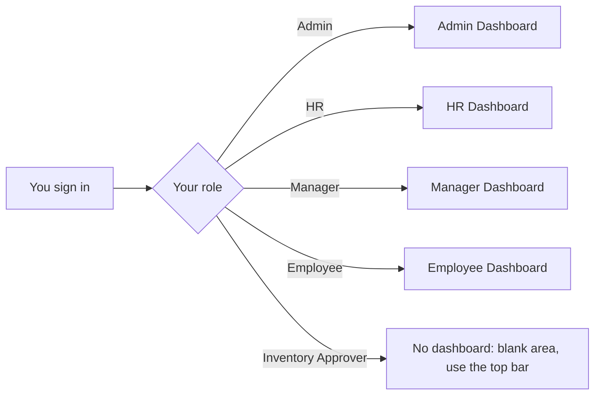

After you sign in, Busiman opens the dashboard for your role.

The diagram below shows which dashboard opens for each role.

## Admin Dashboard

Shows an **Attendance Dashboard** with today's attendance picture, followed by cards named System Management, Reports & Analytics, Proxy Management and Settings. The cards are descriptions only. They are not buttons. Use the top bar to reach features.

## HR Dashboard

Shows the **Attendance Dashboard** and cards named Employee Management, Recruitment and Payroll. The cards are text only. Use **Settings > Workforce** to manage employees.

## Manager Dashboard

Shows the **Attendance Dashboard** and cards named Team Management, Performance Reviews and Reports. The cards are text only.

## Employee Dashboard

Shows the **My Attendance** panel, where you check in and out (see [Attendance](/docs/desktop-app/attendance)), plus cards named My Profile and Leave Requests. The cards are text only, and there is no leave feature in the desktop app.
