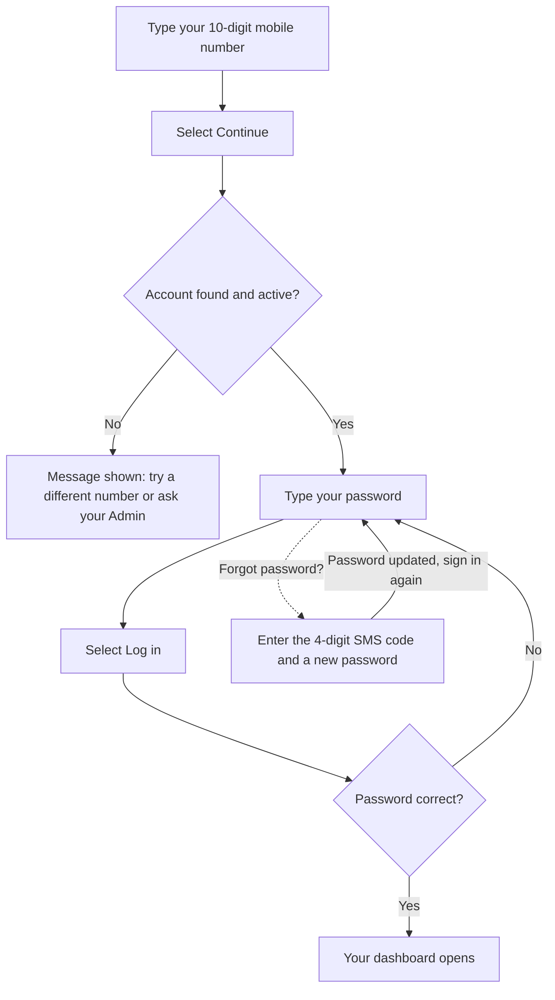

## Before you begin

You need three things:

- A Windows or macOS computer with an internet connection.
- The Busiman installer from your company.
- An account that already exists. Your Admin or HR creates your account. You cannot create an account or a new company in the desktop app. New companies are created in the Busiman mobile app.

You also need your 10-digit mobile number and your password.

## Install the app

**On Windows**

1. Run the Busiman installer you were given.
2. Follow the installer pages. You can choose the folder where Busiman is installed.
3. Finish the installer. Shortcuts are added to your desktop and Start menu, and Busiman usually opens when the installer ends.

**On macOS**

1. Open the Busiman disk image you were given.
2. Move the app into your Applications folder, then open it.

If the app says "Application Error - Could not load the application files. Please reinstall the application.", install it again.

## First launch

Busiman opens straight to the sign-in screen. There is no welcome tour.

The app does not show a version number anywhere. If support asks which version you have, check the installer file name or your computer's list of installed apps.

## Sign in

Busiman signs you in with your mobile number first.

The diagram below shows the steps from typing your number to reaching your dashboard.

1. Type your 10-digit mobile number in **Mobile number**. Use the number without +91. The screen is set up for Indian mobile numbers, which start with 6, 7, 8 or 9.
2. Select **Continue**.
3. Type your password in **Password**.
4. Select **Log in**.

You land on your own dashboard (see [Dashboards](/docs/desktop-app/dashboards)).

### What can appear after you press Continue

| What you see | What it means | What to do |
|---|---|---|
| "Enter a valid 10-digit mobile number." | The number is not in the expected format. | Re-type it with exactly 10 digits. |
| "No account found for +91 (your number) on this company." | No account exists for that number. | Select **Try a different number**, or ask your Admin or HR to create your account. |
| "This account isn't active. Contact your admin to get access restored." | Your account has been switched off. | Contact your Admin. |

### Sign in with email instead

If you prefer, select **Sign in with email instead**. Enter your email address or phone number and your password, then select **Sign In**. Select **Use phone number instead** to go back.

### Forgot your password

1. On the password screen, select **Forgot password?**.
2. Busiman sends a 4-digit code by SMS to your number.
3. Type the code in **Verification code** and select **Verify**.
4. If no code arrives, wait for the countdown ("Resend code in ...s", 30 seconds) and select **Resend code**.
5. Enter a **New password** (at least 8 characters) and re-enter it in **Confirm new password**.
6. Select **Update password**.
7. You see "Password updated. Sign in with your new password." Sign in again with the new password.

Resetting your password does not sign you in on its own. You always sign in again afterwards.

### Sign-in messages

| Message | Meaning |
|---|---|
| "Incorrect password." | The password is wrong. Try again or use **Forgot password?**. |
| "Too many attempts. Please wait a bit and try again." | Too many tries. Wait a few minutes. |
| "No connection to the server. Check your network and try again." | Your computer is offline or cannot reach Busiman. |
| "Company data was reset. Use the new administrator email and password you saved." | Your company's data was deleted by an Admin. Use the new Admin email and password that were shown at the time. |

## The Busiman window and the tray icon

- The window has a top bar with your pages: Dashboard, Attendance, Inventory, Sales, Purchases, Service, Calendar and Settings. You only see the ones your role and branch can use. Dashboard and Settings are always there.
- Your company name and your role (shown in short form, for example `hr` or `admin`) appear at the top right. Selecting them opens a small menu with **Settings**.
- **Closing the window does not quit Busiman.** It hides to the small tray (notification area) icon so attendance can keep working in the background. No message tells you this.
- To reopen it, double-click the tray icon, or right-click it and choose **Show Busiman Desktop**. On Windows a single click also shows or hides the window.
- To really quit, right-click the tray icon and choose **Quit**. Quitting does not ask whether you want to check out.
- If you start Busiman a second time, it simply brings the existing window forward.

## Busiman starts with your computer

Busiman is set to start when you sign in to your computer, and on Windows it starts hidden in the tray. There is no switch for this inside Busiman. To change it, use your computer's own startup settings (Windows: Settings > Apps > Startup, or Task Manager > Startup; macOS: Login Items). If you start Busiman by hand later, it may turn itself on again.

## Updates

Busiman checks for updates a few seconds after it opens, and then every 4 hours.

1. A box titled **Update Available** appears. It says "A new version (x.y.z) is available." The number shown is the **new** version, not the one you have now.
2. Choose **Download Now** to download it, or **Later** to skip for now. If you choose **Later**, nothing is downloaded and the box comes back at the next check.
3. After the download, **Update Ready** appears. Choose **Restart Now** to install straight away. If you choose **Later**, the update installs the next time you quit Busiman.

Update problems are not reported on screen.
