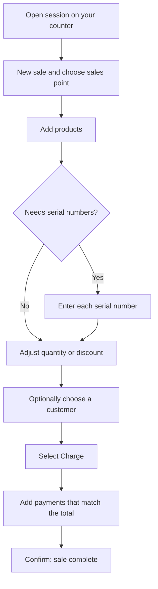

Open **Sales** to sell at the counter, manage orders, customers, returns and quotations. You need the Sales module.

The tabs are **Orders**, **Customers**, **Sales points**, **History**, **Returns** and **Settings**. A red marker on **Sales points** means none exists yet.

Admins see a **- Select branch -** menu at the top to choose which branch they are working on. Other roles work in their own branch.

## Before your first sale: open a sales point session

A **sales point** is a counter or till. A sale can only be made while that counter has an **open session**.

1. Go to **Sales** > **Sales points**.
2. If no counter exists yet, create one.
3. Select **Open session** on your counter.

At the end of the day, return here and select **Close session**.

If the session is closed, you will see messages like "This counter session is closed. You can't make a sale from this sales point." You will not be able to Charge, Save as order or make a Quotation until you open it.

In Sales points you can also edit counters and their payment methods, price list, printer, receipt, staff and hardware.

The diagram below shows the path from opening a counter session to a completed sale.

## Make a sale

1. Open **Sales** > **Orders**, then select **+ New sale**.
2. Choose your sales point.
3. Add products. Scan a barcode, search, or use the quick-add cards. If a product has variants, choose the variant. Press **Ctrl+K** to jump to product lookup.
   - If a product needs serial numbers, select **Pick** on its cart line (or open the line) and scan or type each serial number. **Charge** stays greyed out until every required serial number is entered.
4. Adjust quantity, unit or discount where needed.
5. Optionally choose a customer or create one quickly. A customer is required for a quotation.
6. Select **Charge** (or press **Ctrl+Enter**).
7. In the checkout box, add the payments. You can split a payment across methods such as Cash, Card and UPI, or put it on the customer's account. The payments must add up to the total.
8. Confirm.

To print or save a receipt later, open the order from the list and select **Print Receipt**.

### Other things you can do at the counter

- **Save as order** - keep the sale as an order for pickup or payment later. It needs an open session.
- **Hold order** - set the current cart aside to serve another customer. You see "Order held (draft saved)". If the cart is empty you see "Add items before holding". Held orders are stored on this computer, shared by everyone who uses the same sales point on it.
- **Quotation** - create a quotation (price proposal) from the cart. A customer is required, and a session must be open. You can print or share it from the order.

### When Charge is greyed out

Charge is unavailable when any of these is true:

- there are no items in the cart,
- no sales point is chosen,
- the session is not open,
- stock is not enough and negative selling is not allowed,
- a product needing serial numbers is missing them,
- the customer is not allowed to buy, or
- the payments do not add up to the total.

### Backdating a sale

Choosing a past date for a sale is allowed only for Admins and people who have been given the "Backdate Sales" permission. The date cannot be more than 2 days ahead of today.

## Orders

Open any order to see its items, payment details, what is still owed, and related orders. From here you can print the receipt, print a quotation, share a quotation link, or start a refund or return.

## Customers

List customers, filter them and add new ones. Open a customer to see their lifetime value, outstanding balance, payment reliability, orders, quotations, returns, activity and notes. Use **Export** to save the list.

## History

A record of past sales. **Export CSV** saves a file named like orders-2026-10-14.csv (a simple spreadsheet file that opens in Excel) with columns such as Order #, Customer, Phone, Status, Total, Payment and Sale date.

Each row has a menu. For completed sales it offers **View**, **Refund** or **Return**, and **Download invoice**. **Download invoice** opens the sale with its receipt print view. There is no separate invoice document yet. For quotations the menu offers **View**, **Convert to order**, **Open customer** and **Download quotation**. Other rows offer **View**, **Edit**, **Duplicate** and **Refund**.

## Returns

To take back goods, select **New return** and follow five steps:

1. **Find order**
2. **Select items**
3. **Reason & location** - choose why (for example Customer changed mind, Defective / wrong item, Damaged in transit, Not as described, Size / fit, or Other) and where the goods are received back. The "location" is where stock is received in your system, not the customer's address.
4. **Refund method** - Cash, Store credit, Bank transfer or Exchange only.
5. **Review & submit**

If you submit without choosing any quantity you see "Select at least one line with a return quantity." If the return does not go through you see "Return failed". The default return window is 30 days from the order date when the product's own policy is not available.

## Sales settings

In **Sales > Settings** you can set the tax rate, whether prices include tax, whether selling below zero stock is allowed ("Allow negative POS (stock)"), and price-list item overrides.

Amounts are shown in rupees.
