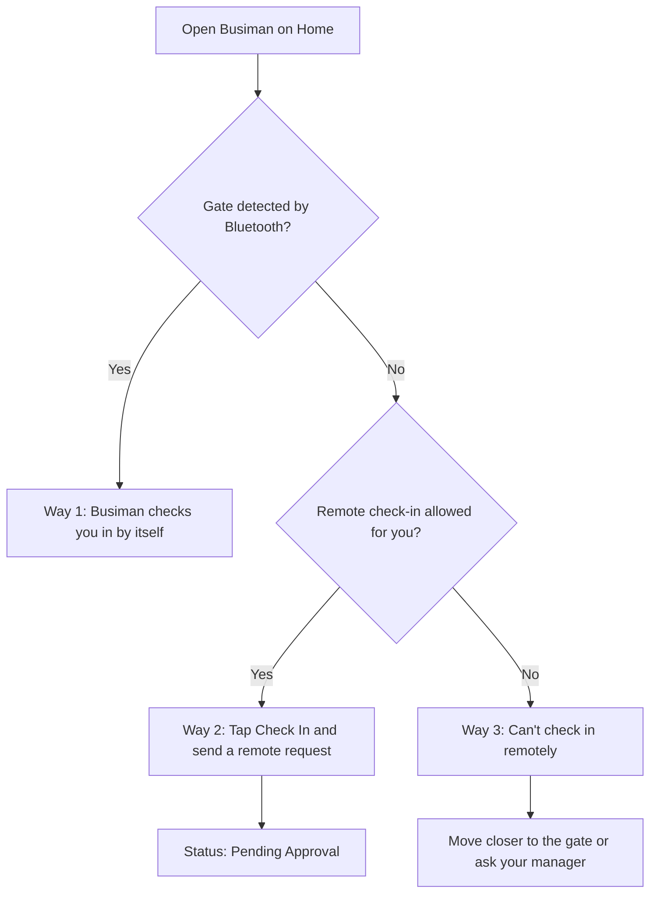
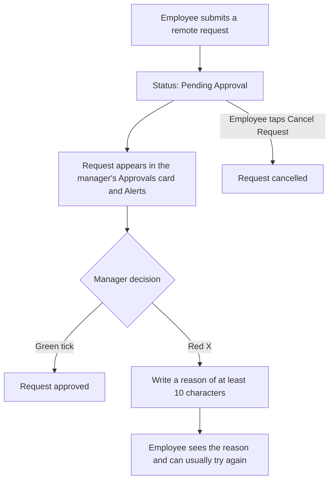

Attendance tells your company when you start and finish work. The **Check In** button on the employee Home does not depend on the Attendance department in the app; the company's server decides whether a check-in is accepted. Approvals, **Your Employees**, marking attendance for others and the floating pill need the Attendance department.

## Self check-in: three ways

Your own check-in does not use GPS. You prove you are at work either through the office **gate** over Bluetooth, or by sending a **Remote** request with a reason.

The diagram below shows the three ways your own check-in can go.

### Way 1: the office gate (automatic)

The gate is a device at your workplace. While Home is open, your phone looks for it using Bluetooth.

1. Open Busiman on Home when you arrive.
2. The message says "Scanning for office gate…".
3. When the gate is found, the message changes to "Gate detected — marking your check-in…". **You do not need to tap anything.** Busiman checks you in by itself.
4. You see "Checked in at the gate" for a few seconds. The status card shows **Checked In** with the time. Your phone also shows a notification: "Checked in" and "Marked automatically at the office gate."
5. Check-out works the same way: "Gate detected — marking your check-out…", then "Checked out at the gate".

If the automatic try fails, you see a red message and a notification, "Couldn't check in at the gate" with "Open the app to check in yourself." Tap **Check In** yourself.

Other messages you may see about the gate:

| Message | What to do |
|---|---|
| Bluetooth permission needed to check in at the gate — tap to allow | Tap it and allow "Nearby devices" |
| Turn on Bluetooth to check in at the gate — tap to enable | Tap it, or turn Bluetooth on in your phone settings |
| Bluetooth gate check-in not available on this device | Your phone cannot use the gate. Use a remote request if you are allowed |

If you tap **Check In** while the gate has been detected in the last moments, Busiman sends the gate proof and shows "Success".

### Way 2: a remote check-in request

You can ask for a remote check-in when there is no gate signal and one of these is true:

- Your branch has no attendance gate at all. Then every check-in and check-out is remote for everyone.
- Your admin turned on **Check-in without office network** (for check-in) or **Check-out without office network** (for check-out) for you.

Steps:

1. Tap **Check In** (or **Check Out**).
2. Busiman first shows "Checking today's schedule…".
3. If you have an on-site service job today, you see "You have a job scheduled today" with the job. The job is already chosen. Tap a different job only if you want to pick another one, then tap **Submit for approval**. Or tap **Not this? Enter an explanation instead**.
4. Otherwise a form opens, titled **Remote check-in** (or **Remote check-out**):
   - **Marking from**: choose **Home**, **Client site** (the default), **Travel** or **Other**. If you pick **Other**, type where you are in **Specify location** (at least 3 characters).
   - **Explanation**: say why you are not on site (up to 500 characters, with at least one letter). Tap **Voice** to speak instead. The button then says **Listening**, and you tap **Stop** to finish.
5. Tap **Submit for approval**. A message says "Submitted". Your status becomes **Pending Approval** ("Waiting for manager approval").
6. Changed your mind? Tap **Cancel Request**. A message says "Cancelled".

### Way 3: you are not allowed to check in remotely

If there is no gate signal and remote check-in is not allowed for you, a message appears: "Can't check in remotely" (or "Can't check out remotely"). It tells you to move closer to the office gate, or to ask your manager to enable it for you.

## Approvals

Managers, HR, admins and attendance officers see an **Approvals** card on the team Home.

The diagram below shows what happens to a remote request from the employee to the manager and back.

Each row shows the employee's name, **Check-in** or **Check-out** with the date, the note they wrote, and "Submitted" with the time. Each row has two round buttons with no words:

- The **green tick** approves the request.
- The **red X** rejects it.

To reject:

1. Tap the red X. A sheet titled **Reject request** opens.
2. Write a reason in the box "Reason for rejection". You need **at least 10 characters**. A counter shows "n/10 characters minimum".
3. Tap **Reject** (or **Cancel** to go back). The employee sees your reason.

If the employee cancelled first, a message says the request was cancelled. If someone else already decided, a message says it was already approved or rejected.

The same requests also appear in your **Alerts**. When you tap one there, an approval sheet opens.

**If your request is rejected:** you see a red **Request rejected** box on Home with the manager's reason. You can usually try again.

## Marking attendance for someone else

Admins, HR and attendance officers can do this. Open **Your Employees** on Home, tap a person, and use the buttons on their attendance page:

- **Mark attendance** opens a sheet titled **Mark attendance**. Choose **Check in** or **Check out**, set the **Date** (not in the future) and **Time**, and add an **Override reason (optional)**. Tap **Save**. A message confirms. This is the only time Busiman asks for your phone's location. If you say no, the attendance is still saved.
- After the person has checked out, the button changes to **Clear attendance**. Tap it and confirm to remove today's attendance. They can be marked again.
- Admins also see a red **Logout** button here. **Read "Admin tools" before you tap it.**

Managers who are not attendance officers can open the page but do not see these buttons.

## The employee attendance page

The page shows:

- The person's photo, name, role, department and email. Admins also see two round buttons: a fingerprint and a pencil, and an **Online** or **Offline** badge.
- **Today's attendance** with Check-in, Check-out, Duration and Status, and the person's shift.
- **Attendance history**. Choose **7 days**, **30 days** or **90 days**. The round download button exports the list. Pick **CSV** or **PDF** in **Export Attendance Data**, tap **Export**, then share the file from your phone's share sheet. You see "Success" when it finishes.
- For admins, **Access & permissions** (see "Admin tools").

## Admin tools for attendance

**Access & permissions** (admins only) is on an employee's attendance page. It is folded away; tap its heading to open it. It has switches for **Proxy server**, **Check-in without office network** and **Check-out without office network**. They save by themselves. In **Edit employee** the same settings sit in the **Permissions** card, where the first switch is called **Proxy permission**, and the two remote switches show only when the branch has a gate. These switches decide who can send remote requests when the branch has a gate.

**Fingerprints.** The fingerprint button on an employee's page enrols fingerprints on the **gate device**, not on your phone. You choose the gate, tick a consent box that the employee agreed, and tap **Start enrolment**. The gate asks the employee to place a finger twice. You can later tap **Remove at this gate**.

**Gate devices** (Profile > Company > **Gate devices**). Here admins add and check gates. Tap **Add gate device**, give it a name, choose the branch, find the gate nearby, enter the six-digit PIN shown on the gate's screen, send your Wi-Fi name and password to the gate, and wait for "Gate online". Existing gates show if they are Online or Offline.

## Reminder when you reach the office Wi-Fi

On Android, when your phone joins your office Wi-Fi and you still need to check in or out, a notification says "Connected to office WiFi" and "Please mark your attendance." It is only a reminder. It does not check you in. To turn it off, mute the "Office WiFi Alerts" channel in your phone's notification settings.

## The floating check-in pill (managers, HR, attendance officers)

If you are a manager, HR or attendance officer in a branch with Attendance, a small pill floats on most main screens. It says **Check In**, **Check Out**, **Cancel request**, **Done for today**, "Scanning for gate…", "Gate detected" or "Bluetooth off — Remote". You can drag it to a side of the screen. It follows the same gate and remote rules as the Home button. It does not appear on the Call screens or inside Service and Kit. Admins do not see it.

## Month summary

Employees see **Present**, **Absent** and **Late** for the month on Home. Busiman has no calendar view or day-by-day detail screen. Your own attendance also appears in **History**.
