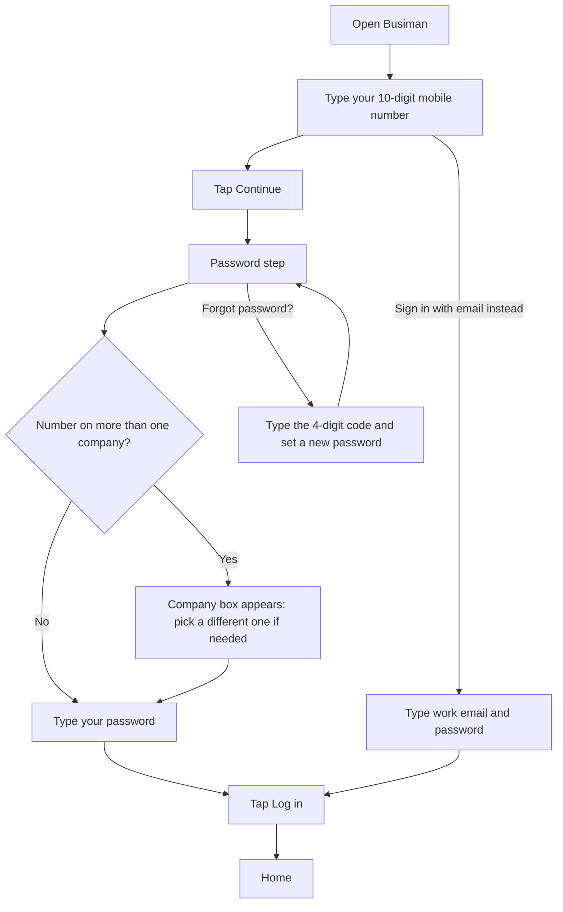

## Quick start

1. Install Busiman on your Android or iOS phone.
2. Open the app and type your 10-digit mobile number.
3. Tap **Continue**.
4. Type your password and tap **Log in**.
5. Allow notifications when your phone asks.

If your number is new to Busiman, the app guides you through creating a company instead (see "Create a new company").

## Sign in

Busiman signs you in with your **mobile number** and a password. You do not type a company code.

The diagram below shows the steps from opening the app to being signed in.

1. Open Busiman. For a moment you see a loading screen, then "Checking your session…". If you are already signed in, you see "Opening your dashboard…" and then Home.
2. On the first screen you see "Free Business Management Software" and "Attendance, Inventory, Accounting all in one app". Type your number in the **Mobile number** box. It must be 10 digits.
3. Tap **Continue**.
4. If Busiman knows your number, you see the password step. Type your password. Tap the eye to show or hide it.
5. If your number is on more than one company, a **Company** box appears with your first company already chosen. Tap it to pick a different one.
6. Tap **Log in**.

Made a mistake in the number? Tap **Change number** at the top of the password step.

**Sign in with email instead.** Below the **Sign up with Google** button there is a link, **Sign in with email instead**. Use it if your account has an email but no phone number. Type your **Work email** and **Password**, then tap **Log in**. To go back, tap **Use mobile number instead**.

> **Note:** If your phone is offline, you see "You are offline. Connect to the internet to sign in." and the buttons are switched off until you reconnect.

## Create a new company (owners)

If you type a number that Busiman does not know, the app starts a new-company signup.

1. A screen titled **Enter the code** appears. Busiman sends a 4-digit code to your number.
2. Type the code and tap **Verify**. If it does not arrive, tap **Resend code**. You can ask again after a short wait (it counts down, for example "Resend code in 25s").
3. Fill in the four steps:
   - **Your company**: type your **Company name** and a **Company code**. The code is made of lowercase letters, numbers and hyphens, at least 3 characters. The code identifies your company. The screen says the code is how your team signs in, but that text is out of date: everyone signs in with their mobile number. Tap **Continue** when you are done.
   - **Your account**: type **Your name**, your **Work email**, a **Password** (at least 8 characters) and **Confirm password**. Tap **Create company**.
   - **Branches & features**: name your **Main branch** and give it a **Branch code** (for example MUM01). Tap **Add another branch** if you have more; each extra branch also asks for a **Branch code**. Each branch shows how many of 8 features are on, for example "8 of 8 features enabled". Tap the row to open the list and switch features on or off: Attendance, Inventory, Sales, Purchases, Calendar, Service jobs, Expenses and Payroll. A new main branch starts with all of them on. Tap **Continue** when you are done.
   - **Review & finish**: check each branch. Tap **Finish setup** to save, or **Skip for now** to keep everything on. You can change branches and features later.
4. Next comes **Verify your email**. Busiman sends a 6-digit code to your email. Type it in **Verification code** and tap **Verify**. If you are busy, tap **Skip for now — I'll verify later**.

You can leave signup and come back. Busiman remembers where you stopped for a while (about 30 minutes for the phone code, up to 7 days for the branch step). On the first company step, **Not you? Log out** lets you leave.

**If you skipped email verification:** a banner reading "Verify your email" and "Keep full access to your account" floats above the bottom bar. Tap **Verify**, type the 6-digit code, and tap **Verify** again. Tap **Resend code** if you need a new one. A small **X** on the banner hides it for good. The banner shows on every main screen until you verify or hide it.

## Employees: your first sign-in

Your admin creates your account. You do not sign up yourself.

1. Ask your admin for the mobile number and password they set up.
2. Open Busiman, type your number, tap **Continue**.
3. Type the password your admin gave you and tap **Log in**.
4. Change your password in **Profile** > **Change password** if you like.

If an admin created your account without a phone number, use **Sign in with email instead**.

## Forgot your password

1. Type your number and tap **Continue**.
2. On the password step, tap **Forgot password?**
3. Type the 4-digit code Busiman sends to your number and tap **Verify**.
4. On **Set a new password**, type a **New password** (at least 8 characters) and **Confirm new password**. Tap **Update password**.
5. You return to the password step with the green line "Password updated. Sign in with your new password."

Password reset works with your phone number. If you only sign in with email, ask your admin for help.

## Password length at a glance

| Where | Minimum length |
|---|---|
| Company signup and password reset | 8 characters |
| **Change password** in your profile | 6 characters |
| Admin creating an employee | 6 characters |

A longer password is safer. We suggest at least 8 everywhere.

## Notification prompt

Right after you sign in, your phone asks for permission to send notifications. Please say yes. Busiman uses notifications for shift reminders, approvals, job updates and incoming calls.

If you say no, Busiman asks again each time you open Home. A message reads "Turn on notifications" and explains that you will miss shift reminders, approvals and job updates. Tap **Open Settings** to turn them on, or **Not now** to dismiss it for the moment.

## Other permissions

Busiman asks for the rest only when you use a feature:

| Permission | Asked when you... |
|---|---|
| Bluetooth ("Nearby devices" on newer Android) | tap the Bluetooth message on Home to use the office gate |
| Camera | open the scanner for the first time, or take a profile photo |
| Microphone | make a call, or use the voice buttons to speak a reason or a problem |
| Contacts | open your phone-book contacts in Call |
| Location | HR or an admin marks attendance for someone else |
| Photos | choose a photo for your profile or logo |

Your own check-in does not use your location.

## Updates

Busiman updates itself. It checks quietly when you open it and about once an hour, and again when you come back to it after more than 5 minutes away.

When an update is ready you see a popup:

1. **Update Available**: "A new version is available. Would you like to download it now?" Tap **Download Now**. You see "Downloading update...".
2. **Update Ready**: "A new version has been downloaded. Restart the app to apply the update." Tap **Restart Now**.
3. If something goes wrong you see **Update Error** with **Retry** and **Dismiss**.

> **Important:** You cannot close this popup. **Later**, **Dismiss** and the phone's back button do nothing. The app stays behind the popup until you tap **Download Now**, **Restart Now** or **Retry**. Plan a minute for it.

To check on your own, open **Profile**. At the bottom you see "Version" and a button: **Check for updates**, then **Download update**, then **Restart to update**. If there is nothing new, no message appears.

## Security and sign-in notes

- Busiman has no fingerprint or face login and no app lock. Anyone who opens your unlocked phone and Busiman is you. Use your phone's own screen lock.
- Busiman has no "Sign up with Google" (see "Not available yet").
