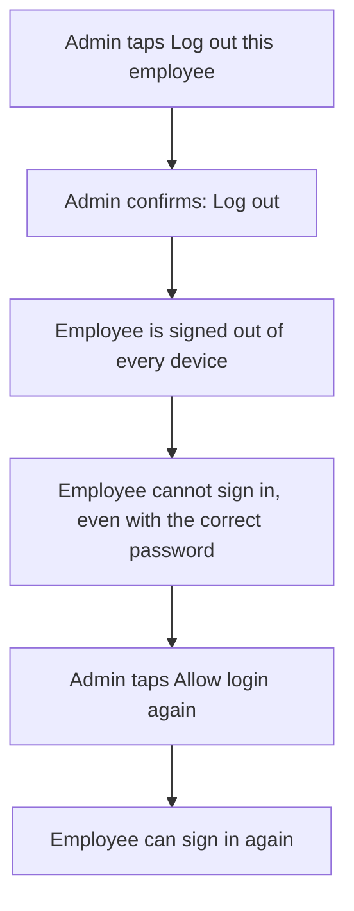

Tap your avatar to open **Profile**. At the top are your name, role, designation, department and email.

## Account

- **Edit profile**: name, contact details, dates and emergency contact.
- **Change password**: update your password (at least 6 characters).
- **My advances**: shown only if your branch has Expenses and you have ever had an advance.

## Business phone

- **Virtual numbers**: your company's business numbers (see "Calling"). Shown only when your company has virtual numbers switched on, for admins too.
- **My calling extension** (admins): turn on calling for yourself.

## Company (admins only)

- **Company management**: branding, contact details and branches. Branches have a **Departments** field, with the **Update branch** or **Create branch** button. Admins can tap **Resend verification email** here.
- **Payment methods**: the cash, UPI, bank and other methods the branch accepts.
- **Gate devices**: set up and check attendance gates.
- **Locations**: warehouses, racks and other places stock lives.

## App

**Version**, and the update button described under "Updates".

## Logging out

- **Admins** see a red **Logout** button. Tap it. A message asks, "Are you sure you want to logout? This will end your session on all devices." Choose **Logout**.
- **Everyone else** sees only the grey text "Your admin manages sign-outs for your account." There is no logout button for managers, HR or employees.

## Admin tools: employees

**Add an employee** (admin only). Use the blue **+** > **Add new employee**, the round person-plus on **Your Employees**, or the setup card. The screen is titled **New employee**.

- **Account**: **Full name**, **Email**, **Password** (the app needs at least 6) and **Phone**. Add the phone number. Employees sign in with their mobile number.
- **Job & access**: **Role** (**Employee**, **Manager**, **HR** or **Admin**), **Branch**, **Modules** (you must choose at least one), the **Leads management** switch and **Designation**.
- **Calling extension**: optional.
- **Permissions**: **Proxy permission**, **Check-in without office network**, **Check-out without office network**, and per-module switches such as **Backdate sales**, **Skip expense approval**, **Skip outsourcing approval** and **Backdate outsourcing**. Note that **Skip expense approval** does not change anything you can see in the app.
- **Shift**: an optional default shift.
- **Salary (optional)**.

Tap save at the top. When all goes well you return to Home with **no success message**. A message appears only if something needs your attention, titled **Created with warnings**.

**Log out this employee** (admin only). Open **Your Employees** on Home and tap the person. Their attendance page opens. Tap the round pencil button at the top to open **Edit employee**. The **Account access** card is near the bottom. It does not appear for admins, so another admin cannot be logged out this way.

The diagram below shows how an admin logs out an employee and later allows login again.

1. Tap the red **Log out this employee** button.
2. Busiman asks, "Log out this employee?" It warns that the person will be signed out of every device right now and cannot log back in, even with the correct password, until you allow it again here. Choose **Log out**.
3. The card now reads "This employee was logged out and can't sign in again until you allow it." and shows **Allow login again**.
4. When the person should work again, tap **Allow login again**.

The employee's app returns to the login screen without any explanation. Before you allow login again, they cannot sign in, even after reinstalling the app.

> **Warning:** The red **Logout** button on an employee's attendance page does the same thing. It ends their sessions and blocks their next login until you use **Allow login again**. It only says "Employee sessions ended." Use **Allow login again** in **Edit employee** to undo it.
