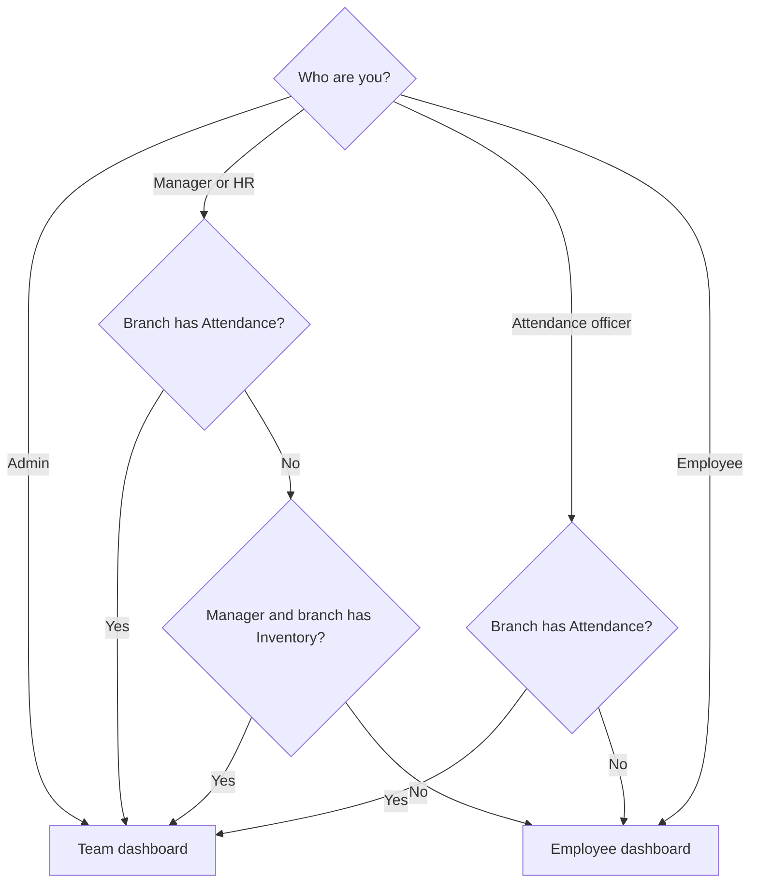

Busiman has four roles. Your admin sets yours.

| Role | Typical person | In short |
|---|---|---|
| **Admin** | Owner or company head | Sees everything. Manages employees, company settings, gates, payment methods and locations. The only role that can log out. |
| **Manager** | Team lead, supervisor | Approves requests. Sees the team dashboard when the branch has Attendance or Inventory. |
| **HR** | HR staff | Can see the team list and mark attendance when the branch uses Attendance. |
| **Employee** | Staff, field engineers | Checks in, sells, does service jobs and sees their own work. |

An admin can also make someone an **attendance officer**. Set it in **Edit employee** > **Permissions** > **Attendance officer** > **Manage** (shown when the person has the Attendance module). The officer can mark, clear and approve attendance for the specific employees the admin picks.

## Departments

A company switches features on per **branch**. These are called **departments**: Attendance, Inventory, Sales, Purchases, Calendar, Service jobs, Expenses and Payroll. If your branch does not use a department, you do not see its tile or tab. Admins see every feature.

## Which Home screen you see

The diagram below shows which Home screen each person sees.

| Who you are | Home screen |
|---|---|
| Admin | Team dashboard (always) |
| Manager or HR in a branch with Attendance | Team dashboard |
| Attendance officer in a branch with Attendance | Team dashboard |
| Admin or manager in a branch with Inventory (approving service parts) | Team dashboard |
| Employee (unless they are an attendance officer, see above) | Employee dashboard |
| HR in a branch without Attendance, or a manager whose branch has neither Attendance nor Inventory | Employee dashboard |

> **Heads-up for managers:** A manager in a branch that has Inventory but no Attendance gets the team dashboard. That screen has no check-in button. If you need to check in, ask your admin whether your branch should use Attendance.

## One branch or many

Normally you work in a single branch. Admins with two or more active branches see a branch name with a small arrow in the top-left of the screen (the full logo shrinks to a small logo, with the branch name and an arrow beside it). Tap it, and the **Select branch** sheet opens. Pick a branch and you return to Home. The data on the other screens switches to that branch.

## What happens when you cannot open something

If your role or department does not allow a screen, Busiman does not show a "not allowed" message. The screen flickers for a moment and you land back on Home (or on the section's own front page). This is normal. If you think you should have access, ask your admin.
