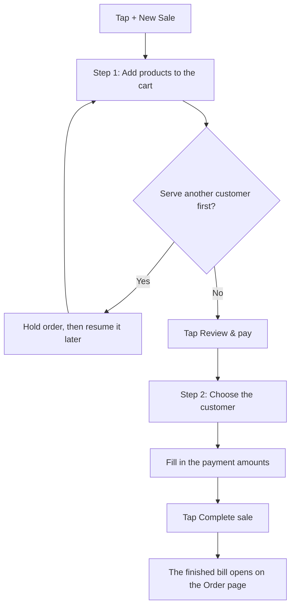

Open **Sales** from Quick Links. The top has four tabs: **Dashboard**, **Orders**, **Counter** and **History**.

## Dashboard

At the bottom-right of the Dashboard tab, just above the bottom bar, there is a blue **+ New Sale** button. It floats there and shows only on the Dashboard tab. To its left are one or two round buttons with no words:

- A **person with a plus** starts a new enquiry. It only shows if you have leads access (admin, manager, HR, or an employee with **Leads management** switched on).
- A **document** starts a new B2B order.

The Orders tab has its own floating **+ New order** button in the same place.

Below the buttons, a pipeline row shows your enquiries as **Active**, **Overdue**, **Due today** and **Won**. Tap one to see that group in the list underneath.

If service jobs are waiting to be billed, a list called **BILLS WAITING** appears at the top (see "Bills waiting").

## Making a sale

The diagram below shows the steps of making a sale.

You need the Sales department. Start from the floating **+ New Sale** button on the Sales Dashboard, or from the blue **+** > **New sale**. Busiman picks your counter for you. If no counter is set up, a card says "No sales counter available". Ask your admin.

**Step 1: the cart (screen title "New sale")**

1. Search with "Search products, SKU, variant…", or use the scan button beside the search box to scan a barcode.
2. Tap a product to add it. If it has variants, the button says **Choose**. Pick one in **Choose variant**. Items with no stock cannot be added.
3. For items that carry serial numbers, a sheet asks for the serial number. Scan it or type it.
4. Change quantities with the minus and plus buttons or by typing. You can edit the unit price in ₹. Busiman looks up the price for you. If it cannot, it adds the item at ₹0 and warns you to check the price.
5. At the bottom you see **Order discount**, **Subtotal**, **Hold order** and **Review & pay**.
6. **Hold order** parks the cart on your phone so you can serve another customer. A message says "Order held". Open the list of held orders on this screen to resume it.

**Step 2: payment (screen title "Payment")**

1. Check the products list. Tap **Edit** to go back.
2. Under **Customer**, the default is "Walk-in (no customer)". Tap **Change** to pick a customer, or **+ New** to add one.
3. Under **Payment**, fill in the amount for each method your company accepts. Cash is filled in for you as the rest of the bill. You can also use **Udhar (on account)** (money the customer owes you) and **Store credit**. Both need a customer.
4. Busiman tells you if something is off, for example "₹x still unallocated." or "₹x over the total — reduce an amount above."
5. Tap **Complete sale**. There is no extra confirmation. The finished bill opens on a page titled **Order**.

A sale can also start from a waiting service bill, from an enquiry or quotation (**Create Sale**), or from an exchange (**Create Exchange**). Those arrive already filled in.

## Counter and register

A **counter** is a billing point with a cash drawer. Admins create counters (Sales > **Counter** tab). Admins, managers and HR see a list of counters; tap one to open it and use any of them. Other staff see their own counter straight away (the one assigned to them, or one that nobody owns).

- **Open register**: type the **Opening cash balance** and tap **Open register**.
- **Close register & count cash**: when the register is open, tap **Close counter**, then type the **Counted cash**. Busiman tells you if it matches. If it does not, you must write a **Note (required for a difference)** to explain. Then tap **Close register**.

Cash expenses need an open register.

## B2B orders

1. Open the **Orders** tab and tap **+ New order**, or tap the document button on the Dashboard.
2. In **Order details**, choose the customer (**Select customer**) and counter.
3. Add items as in a sale. Each line has a quantity, a **Price** and a **Total**.
4. Choose how to discount: **Flat amount**, **Percentage** or **Per product**.
5. Tap **Create order**. The order opens as a **Draft**.

On the order page (title **Order**), which buttons you see depends on the order's status and your permissions. They may include **Cancel order**, **Convert to order**, **Create Quotation**, **Create Sale**, **Collect** (to record a payment), **Share receipt**, and **Return / Exchange**.

Order statuses you may see: **Draft**, **Quotation**, **Confirmed**, **Fulfilling**, **Completed**, **Partially paid**, **On account** and **Cancelled**.

## Quotations

On a B2B order, tap **Create Quotation**. A **Create quotation** screen shows the tax lines and optional **Notes** and **Terms**. Tap **Create quotation**. On the quotation page you can mark it as sent, accepted, rejected or cancelled, and convert it with **Convert to order**.

## Returns and exchanges

1. Open the order and tap **Return / Exchange**.
2. On **Return items**, pick what is coming back and tap **Continue →**.
3. On **Return details**, give the reason and say how the customer is settled.
4. Tap **Submit return**. Or tap **Create Exchange** to start a new sale that is already filled in.

## Enquiries (leads)

If you have leads access, the person-plus button opens **New Enquiry**. Choose or create a customer, say what they are interested in (a microphone button lets you speak), and optionally add an estimated value, a source (Call, WhatsApp, Walk-in, Website, Referral or Other), a priority (High, Medium or Low), and a follow-up date. Tap **Save**. Enquiry statuses are New, Contacted, Negotiating, Quoted, Won and Lost. Your enquiries are also listed in a leads list you can search with "Search leads, name, company…".

## Sales History tab

The **History** tab on Sales lists past sales. Search with "Search order#, customer, phone…" and tap **Load more** to see older ones.

## Bills waiting

When a technician sends a service bill to the counter, it shows up as **BILLS WAITING** on the Sales Dashboard, with the customer, how long ago, and the amount. The cashier taps a row, a new sale opens filled in with the job's parts and charges, and finishing it with **Complete sale** removes it from the list.

## Customers and overdue

Customers live under **Parties**. A customer page shows contact buttons (phone, WhatsApp and email), totals such as **Outstanding** and **Orders**, details, a team notes box, and **Add balance** for store credit. The **Overdue customers** list is reached from the Sales Dashboard.
