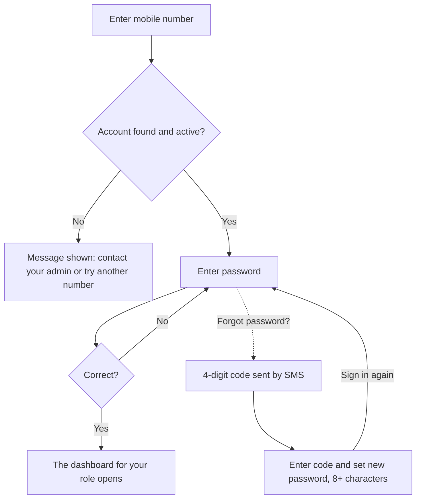
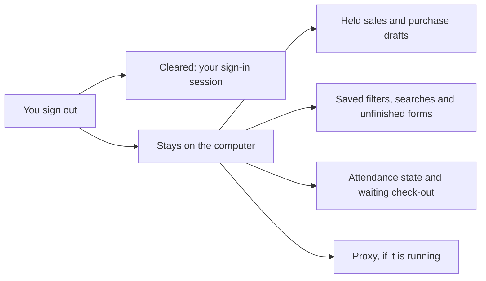

## Overview

This guide explains how Busiman Desktop helps keep you and your business data safe, what the app stores on your computer, and what you can do to stay safe. It is written for business owners, managers and staff.

Busiman Desktop is the Windows and Mac app for attendance, inventory, sales, purchases, service jobs and the calendar. Your business data lives on Busiman's servers. The desktop app is the window you use to reach it.

> **A note on honesty.** This guide only describes what we can confirm from the desktop app itself. Things that Busiman's servers do, such as how passwords are protected, how long a sign-in lasts and how many wrong attempts are allowed, are handled by Busiman's servers. We do not list specifics here.

## The short version

- You sign in with your phone number and password. Your connection to Busiman uses HTTPS (an encrypted connection).
- What you can see and do depends on your role. Busiman's servers make the final decision.
- The app keeps you signed in on your computer and starts with the computer. On a shared computer, read the "Signing out, and shared computers" section.
- The app reads your Wi-Fi name and a device ID to check attendance. Location is only requested in one situation.
- Install updates only from Busiman's own update prompt.

## How signing in works

You sign in with your 10-digit mobile number and your password.

1. **Enter your mobile number.** The app asks Busiman's servers whether the number has an active account on your company.
2. **Enter your password** and choose **Log in**.
3. The app opens the dashboard for your role.

If you prefer, choose **Sign in with email instead** and use your email (or phone number) and password.

You may see these messages:

| Message | What it means |
|---|---|
| "This account isn't active. Contact your admin to get access restored." | Your account is switched off. Ask your administrator. |
| "No account found for +91 ... on this company." | The number is not registered. Check it, or ask your administrator. New companies are created in the Busiman mobile app. |
| "Incorrect password." | The password did not match. |
| "Too many attempts. Please wait a bit and try again." | Busiman's servers are limiting repeated attempts. Wait, then try again. |
| "No connection to the server. Check your network and try again." | Check your internet connection. |

## Resetting a forgotten password

1. On the password step, choose **Forgot password?**
2. Busiman sends a 4-digit code by SMS to your mobile number.
3. Enter the code. You can ask for a new one after a 30-second wait (**Resend code**).
4. Choose a new password of **at least 8 characters** and enter it twice.
5. Sign in again with the new password. Resetting does not sign you in automatically.

How long the code lasts and how many tries you get are handled by Busiman's servers.

The diagram below shows the sign-in steps and the forgotten-password path.

## Changing your own password

You do not need an administrator to change your password. Open **Settings > Account** and use the change-password form. Use at least 8 characters, even though the form may accept fewer.

## Staying signed in

After you sign in, the app keeps your session on your computer so you do not have to type your password every time.

- Each time the app starts, it re-checks your saved session with Busiman's servers. If the servers no longer accept it, you are signed out.
- If you simply have no internet, you stay signed in. Actions that need the servers will not work until the connection returns.
- If an administrator changes your role or permissions, the app picks it up without you signing in again.
- If your session ends, the app takes you back to the sign-in screen without a message.
- Closing the Busiman window does not quit the app. It hides to the system tray (the small icons near the clock) and keeps running so attendance can be marked.
- By default the app starts with your computer, hidden in the tray, and is still signed in as the last person who used it. The app has no setting for this. You can change it in your operating system's startup settings, but the app may switch it back on the next time it is opened.

## Signing out, and shared computers

In the current version, **only the Administrator sees a Logout item** in the user menu. Managers, HR and Employees do not.

This matters most on a computer that more than one person uses, such as a shop counter.

**What to do on a shared computer**

- Remember that Busiman starts with the computer and stays signed in as the last person who used it. If automatic check-in is on (it is on by default), it can check that person in when someone else turns the computer on. Ask your administrator to sign the previous person out, or turn off **Enable Auto Check-In on App Start** in **Settings > Attendance** for that account.
- If you see a **Previous Session Check-out** message for a session that is not yours, choose **Skip**. A check-out that is waiting to be sent is not tied to one user, so the next person on the computer may be shown it.
- Ask your administrator to sign you out when you finish. Administrators can sign any online user out from Settings > Workforce.
- Ask your administrator to reset your password if you think someone else has been using your session. This also signs you out.
- Do not leave anything sensitive in held sales drafts or other drafts (see the next section).
- Where possible, give each person their own Windows or Mac user account on the computer.

**What stays behind after a sign-out.** Signing out clears your session. It does not clear drafts, saved filters or the attendance state kept for automatic check-out (see below). The next person who signs in on that computer may see them. Signing out also does not switch off the proxy if it is running (see "The optional local-network proxy").

The diagram below shows what is cleared and what stays on the computer after a sign-out.

## What the app stores on your computer

The app keeps some information in its data folder on your computer so it can work smoothly.

| What | What it contains | Good to know |
|---|---|---|
| Sign-in session | Your profile details and the sign-in tokens the app uses to talk to Busiman | Kept on your computer in a way that is **not encrypted by the app**. It relies on your computer's own user account protection. |
| Attendance state | Your last check-in and check-out times, last network, device ID and any check-out waiting to be sent | Not guaranteed to be encrypted. Treat it as readable by anyone with access to your computer account. The waiting check-out is not tied to one user. |
| Preferences | For example, whether automatic check-in is on | Kept as a plain file |
| Attendance log | A plain-text record of automatic check-in attempts (time, result, reason, network type). It does not contain passwords or sign-in tokens | Not cleared at sign-out. It is deleted only if it has not been used for 7 days, so on a computer used every day it keeps growing. |
| POS and purchase drafts | Held sales carts (products, quantities, prices, serial numbers) and held purchase receipts, plus a saved supplier list | They are **kept after you sign out** and can be seen by the next user of the same sales point or branch on that computer. Held sales drafts do not include customer records. |
| Interface preferences | Filters, recent searches, unfinished product forms | Kept until cleared |

Uninstalling the app does not remove this data folder.

Because of this, **keep your computer account protected** with a strong password and lock it when you are away. Anyone who can open your computer account may be able to read this information.

The app does not include analytics or advertising trackers.

## Roles: who can see and do what

Busiman has these roles: **Admin, HR, Manager, Employee**, and **Inventory Approver**.

- Each role has its own dashboard and its own set of screens. If you open a page that is meant for another role, the app sends you back to your own dashboard.
- Modules (Attendance, Inventory, Sales, Purchases, Service, Calendar) only appear if your branch has them. Admins see all.
- Administrators and HR can give individual people extra permissions, such as back-dating sales, marking attendance for others, or acting as a proxy device.
- Sensitive changes, such as changing a role or shift, ask for a confirmation and often a written reason, which is recorded. Each employee has a System Audit section showing when the account was created, last updated and last signed in.

Examples, at the level of the desktop screens:

| Action | Who |
|---|---|
| Check yourself in or out manually on the Employee Dashboard | Employee |
| Mark or clear attendance for someone else | Admin, HR, or an Attendance Officer for their assigned people |
| Add, edit or remove employees | Admin, HR |
| Sign other users out and reset their passwords | Admin |
| Company, branch settings and company data wipe | Admin |

> **Important.** The screens hide what you are not allowed to use, but the screens are not the final gatekeeper. **Busiman's servers check every request again.** If a button is visible and the server says no, the server wins.

An Inventory Approver can approve stock counts and open the modules their branch has, but currently has no dashboard of their own.

## What the app reads about your device and network

For attendance, the app needs to know you are at an approved place. Here is what it uses.

| Information | Why | When |
|---|---|---|
| Wi-Fi name and access point ID, or the wired network adapter's address | To check you are on an approved office network | Automatically, when the app checks attendance |
| A device ID (a scrambled code built from details about your computer) | So attendance can be tied to a device | Automatically with auto check-in and check-out. A second, different device ID is made by the app window for manual check-ins. |
| The location of the computer being used | Only when an Admin, HR person or Attendance Officer opens **Mark Attendance** for someone else | The app asks that computer for its location as soon as the dialog opens, without asking first, and sends it if the computer provides one. |

For attendance, the app does not send your computer's name or your Windows user name as plain fields. They are only used, scrambled, to build the device ID. If this computer is used as the office proxy (see below), its computer name is shared with Busiman and is visible to other devices on the office network.

Automatic check-in is on by default and works for every role. The server decides whether a check-in is allowed. You can turn it off with **Enable Auto Check-In on App Start** in **Settings > Attendance**.

When your computer goes to sleep or the screen locks while you are checked in, the app may ask whether you want to check out first. If you choose **Continue** or **Continue Anyway**, nothing is sent, and the app may offer a check-out at that earlier time the next time it starts. Quitting from the tray icon or shutting down does not ask, so check out yourself before you leave.

## Updates

The app checks for updates shortly after it starts and then every few hours.

- **"Update Available"**: A new version is available. The dialog shows the number of the **new** version, not the one you have now. Choose **Download Now** to download it, or **Later** to be asked again at the next check.
- **"Update Ready"**: The update has been downloaded. Choose **Restart Now** to install it, or **Later**. If you choose Later, the update installs the next time you quit the app.

Get the Busiman installer only from your administrator or from Busiman directly. Do not install it from a file someone sends you in a message or email. If Windows shows a warning when you install, check with your administrator before continuing.

## The optional local-network proxy

Some offices use a computer as a **relay** for devices on the same network (for example, a gate device) that cannot reach Busiman directly. This is called the proxy, and it is found under **Settings > Devices > This computer**.

In plain terms: when it is on, that computer listens on your office network and passes requests along to Busiman.

- **It is optional and off unless someone switches it on.**
- **Only switch it on if your administrator has chosen this computer for it and given you permission.**
- When it is on, other devices on your office network can see this computer's name.
- Signing out does not switch the proxy off. To stop it, switch off **Proxy Server Mode** in **Settings > Devices > This computer**, or choose **Quit** from the tray icon.
- If **Auto-Start Proxy on App Start** is on, the proxy starts again the next time anyone opens the app on that computer.
- If you are not sure, leave it off, and ask your administrator.
- Do not switch it on for a computer on a shared or public network.

## Deleting all company data

In **Settings > Company**, an Administrator can choose **Delete all company data**.

- It is available to Admins only.
- It deletes **every record in the company's system**, and cannot be undone. Backups outside the app may still exist.
- The Administrator must tick a box to confirm they understand, type the company's display name exactly, and may enter their current password (recommended).
- Busiman then creates a new administrator account. Its email and password are shown **once**. Copy them straight away.
- The app signs you out when it finishes.

Only use this if you truly intend to start over.

## Your data and privacy

Your business decides what goes into its Busiman account. Busiman's privacy policy explains what is collected, how long it is kept and how to ask for access or deletion. Its main points include that:

- when an admin removes an employee, that person's account and related information are deleted
- when a business deletes its company account, its information is deleted from Busiman's live systems (copies may remain in backups for some time)

For requests about your own data, start with your business administrator. You can also write to Busiman (see below).

## What you can do to stay safe

- [ ] Use a password of **at least 8 characters**. Choose something others cannot guess, and do not reuse it elsewhere.
- [ ] You can change your own password at any time in **Settings > Account**.
- [ ] Never share your password or the SMS code with anyone, including colleagues.
- [ ] **Lock your screen** (Windows key + L on Windows, Control + Command + Q on a Mac) whenever you leave your desk.
- [ ] On a shared computer, ask your administrator to sign you out when you finish. Use a separate computer account for each person if you can.
- [ ] On a shared computer, choose **Skip** if a **Previous Session Check-out** message is not about your session.
- [ ] Do not leave sensitive details in held drafts on a shared computer.
- [ ] Keep the proxy off unless your administrator has chosen this computer for it and given you permission.
- [ ] Install updates only from the in-app update prompt.
- [ ] Keep your operating system up to date and use your computer's security software.
- [ ] Tell your administrator **straight away** if a phone, computer or password is lost, stolen or shared. They can sign you out and reset your password.
- [ ] If you are an administrator, review who has Admin, HR and proxy permissions, and remove people who have left.

## Reporting a security concern

If you think your account has been used by someone else, or you see something that does not look right, change your password in **Settings > Account** if you can, and tell your business administrator so they can sign you out and reset your password.

You can also contact Busiman directly:

- **Email:** team@busiman.org
- **Phone:** +91 75006 73358

Please do not include your password or SMS codes in a message.
