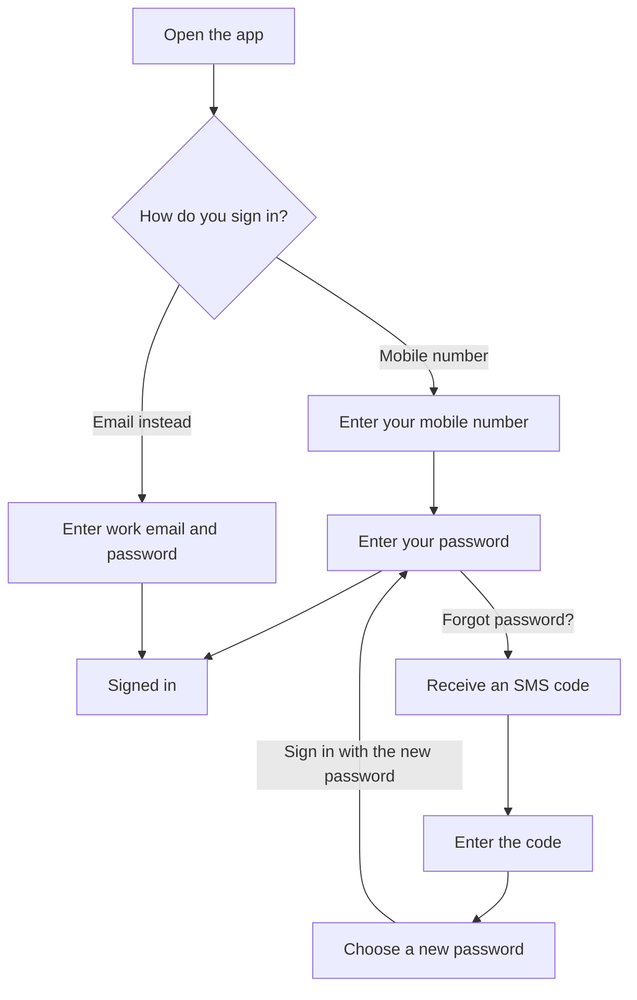
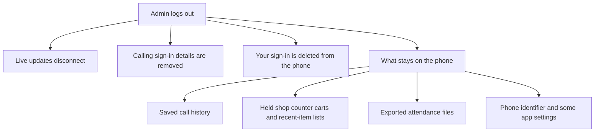

## Overview

This page explains how the Busiman mobile app helps keep you and your business data safe, and what you can do to help. It is written for business owners, managers and staff. You do not need any technical knowledge.

Some protections are built into the app. Others are handled by Busiman's servers, and some depend on how you use your phone. We tell you which is which, and we say plainly where the app has limits.

## The short version

- You sign in with your mobile number (or work email) and a password. The app never saves your password on your phone.
- Your sign-in is kept in your phone's secure storage.
- Only admins can sign someone out. If you are staff and need to be signed out, ask an admin.
- The app does not have a fingerprint or face unlock, and it has no app lock. Your phone's own screen lock is your first line of defence.
- Logging out does not wipe everything from the phone. For example, your saved call history stays.
- On some office networks, the app looks for an attendance helper by itself when check-in is due, and nothing on screen tells you. When check-in is due, use your own office Wi-Fi or mobile data. See [Office-network attendance helper](/docs/security/mobile#office-network-attendance-helper).

## Quick Start: five things to do today

1. Turn on a screen lock (PIN, pattern or password) on your phone.
2. Use a password of at least 8 characters, even where the app accepts 6.
3. Keep your phone's software and the Busiman app up to date.
4. Do not hand your unlocked phone to other people, and do not use a shared phone for your account.
5. If your phone is lost or stolen, tell your admin straight away.

## How sign-in works

### Signing in

- You sign in with your **mobile number and password**.
- If you prefer, tap "Sign in with email instead" and use your **work email and password**.
- There is no "sign in with only a text message code". Text message (SMS) codes are used in two places only: to confirm a new number when you sign up, and to reset a forgotten password.
- There is no Google, Apple, fingerprint or face sign-in. You may see a "Sign up with Google" button, but it only says it is coming soon.
- Password boxes hide what you type.
- The app does not store your password on your phone.
- When you sign in, the app also sends an identifier for your phone. If the app cannot work this out, sign-in stops and asks you to restart the app. Whether an account is limited to one phone is decided by Busiman's servers.

### If you forget your password

1. Enter your mobile number and continue. On the password screen, tap "Forgot password?".
2. Busiman sends a one-time code by text message to that number.
3. Enter the code, then choose a new password. The code alone does not sign you in. You must set a new password.
4. Sign in with your new password.

If you sign in with your work email and have no mobile number on your account, the app cannot reset your password. Ask your admin. The work-email screen has no "Forgot password?" link.

Rules about how long a code lasts, how many tries you get, and how many wrong passwords are allowed are handled by Busiman's servers. If you see "Too many attempts", wait and try again later, or ask your admin.

The diagram below shows the ways to sign in and how a forgotten password is reset.

### Password advice

- The app asks for at least 8 characters when you sign up or reset a password. In some places, such as Change Password and when an admin creates an employee, the app accepts as few as 6. **Please use 8 or more anyway.**
- Admins: when you create an employee's account, give them a password of at least 8 characters and ask them to change it.
- Do not reuse a password from another app or site.
- Never share your password, including with colleagues.

## Staying signed in (and shared phones)

After you sign in, you stay signed in. The app keeps your sign-in in your phone's **secure storage** (Android's protected key storage, or the iPhone Keychain). It is not kept in ordinary app storage.

While you use the app, it checks that your session is still valid. It does this when the app opens, when you come back to it, when the network reconnects, and about every 15 minutes. If Busiman's servers say your session has ended, the app signs you out on this phone and shows the sign-in screen. It may not show a message, so if you are suddenly back at sign-in, simply sign in again.

**What this means on a shared phone:** anyone who picks up your unlocked phone can open Busiman as you. The app has no PIN or fingerprint lock of its own. For this reason:

- Do not use your account on a phone that other people use.
- Do not give your phone to someone else while you are signed in.
- Before you sell, give away or repair a phone, ask your admin to sign you out (see below).

## Signing out

### Who can sign out

- **Admins** see a red **Logout** button at the bottom of Profile. It asks you to confirm. It says this will end your session on all devices.
- **Everyone else** (managers, HR, employees) does not see Logout. Profile shows: "Your admin manages sign-outs for your account."

### What staff should do

If you need to be signed out (for example, you are giving away your phone), **ask an admin**.

### What an admin does

Admins can sign someone out in two places:

- Edit employee, then "Account access", then **"Log out this employee"**. This option does not appear for other admins.
- The employee's attendance page, then **"Logout"**.

Both end that person's sessions. **Both also block that person's next sign-in until an admin taps "Allow login again".** This is true even if they know the right password or reinstall the app. The attendance page button only shows "Employee sessions ended.", so remember the block is applied there too.

When you sign someone out because their phone is lost, this block is useful. When you only wanted to end a session, remember to tap "Allow login again" when the person needs to work again.

### What happens on the phone when you log out

When an admin logs out of the app, it disconnects live updates, removes your calling sign-in details, and deletes your sign-in from the phone. Busiman's servers decide whether other sessions are also ended.

**Logging out does not remove everything from the phone.** See [What is stored on your phone](/docs/security/mobile#what-is-stored-on-your-phone).

The diagram below shows what is removed and what stays on the phone when an admin logs out.

## Roles and what each person can see

Busiman has four kinds of people: **admin**, **manager**, **HR** and **employee**. Some people also get access to certain areas (called departments or modules) and some extra permissions, such as being an attendance officer.

- What you see on screen depends on your role and the areas you have been given. Screens you cannot use are hidden or send you back to the Home screen.
- Admins have the widest access. Only admins see the Logout button, the account-access controls for employees, and the admin approval steps for payroll.
- Your admin decides which areas you can use.

**Important:** hiding a screen in the app is only part of the picture. **Busiman's servers make the final decision** about what each person is allowed to see and do.

If you cannot see something you need, ask your admin to check your role and access.

## What is stored on your phone

| Where on the phone | What is kept | Notes |
|---|---|---|
| Phone's secure storage | Your sign-in details (not your password), your calling sign-in details, and a few small settings and drafts | Protected by your phone's built-in secure storage |
| Ordinary app storage | Your **saved call history** (up to 200 entries: number, name, direction, outcome and times) and some call information | **Not encrypted by the app. Stays after logout.** |
| Files | Exported reports, such as attendance exports, and files you shared | Exported attendance files stay in the app's folders. Other shared files may be cleared by the phone over time. |

**What stays after you log out:**

- Your saved call history. In the app it appears as Call history, then the "This phone" tab.
- Held shop counter carts ("Hold order") and recent-item lists.
- Exported attendance files.
- Your phone's identifier and some app settings.

On a shared phone, the next person could see these. Another reason not to share phones.

**Backups:** Android may include app data in your phone's backups or when you move to a new phone. If you do not want that, check your phone's backup settings.

The app has no advertising or analytics tools built in.

## What the app can access, and why

The app asks for permissions only when a feature needs them. If you say no, the feature that needs it may not work, but the rest of the app keeps working.

| Permission | What it is for | When it asks |
|---|---|---|
| **Camera** | Scanning barcodes and QR codes, and taking a profile or logo photo | The first time you open a scanner or photo feature |
| **Photos** | Choosing a profile photo or company logo | When you choose a photo |
| **Bluetooth** (Nearby devices) | Detecting the office attendance gate to prove you are at the office; admins also use it to set up a gate | When you tap the Bluetooth message on the check-in screen |
| **Location** | Used **only** when an admin, HR or an attendance officer marks attendance for someone else. It records where that was done. **Your own check-in does not use GPS.** If location is refused, the marking still saves. | At the time of marking |
| **Notifications** | Shift reminders, approvals, job alerts and incoming calls | After you sign in; the app reminds you if it is turned off |
| **Contacts** | Reading your phone book so you can dial from it in the Call section. The app reads it on your phone to let you dial. | When you open your personal contacts |
| **Phone / calling** | Showing calls using your phone's normal call screen | When you set up or take a call |
| **Full-screen calls** (Android 14 and later) | Showing incoming calls on your lock screen | Once, after your phone line is set up |
| **Microphone** | Making calls, and voice dictation for a reason or description (you can type instead) | The first time you call or dictate |

The app also checks which Wi-Fi network you are on (its name is checked with Busiman's servers) to remind you about office attendance.

You can turn any permission off in your phone's Settings at any time.

## Attendance and fingerprints

### Checking in

- At the office, your phone picks up a signal from the office gate over **Bluetooth** and checks you in, usually by itself, while the Home screen is open. The signal changes about every 30 seconds.
- If your admin allows it, you can check in remotely by writing a reason. That needs approval.
- Self check-in does **not** use GPS.
- Do not try to check in for a colleague, or help someone check in when they are not at the office.

### Gate fingerprints

- "Fingerprints" in Busiman means employee fingerprints saved **on the office gate**. It is not a phone fingerprint sign-in.
- An admin starts enrolment from the employee's page. The admin must tick a **consent box** saying the employee agreed to have their fingerprint stored on the gate.
- The fingerprint is stored on the gate hardware, not on your phone.
- The gate can later remove it. When an employee is removed, their fingerprints are deleted from the gate first, as the Privacy Policy explains.

## Office-network attendance helper

On some office networks, when you are due to check in or out, the app looks for an attendance helper device on the Wi-Fi by itself. It does not ask you first, and nothing on screen shows it. While the app uses the helper, your activity in the app, including signing in, can go through that device instead of straight to Busiman's servers. That connection is not protected the way the normal connection is, so someone else on the same Wi-Fi could potentially see it.

So:

- When you are due to check in or out, be on **your own office's trusted Wi-Fi** or use mobile data.
- Turn Wi-Fi off, or switch to mobile data, on public, guest or unknown Wi-Fi networks.
- If you often check in away from the office, ask your admin whether remote check-in should be turned on for you.
- If check-in fails with a message about the office attendance helper or "proxy", tell your admin.

Connections from the app to Busiman's servers normally use a secure (encrypted) connection. The helper is the exception described here.

## Calling

Busiman includes a built-in phone system.

- Your calling details are stored in your phone's secure storage and are removed when you log out.
- Your call history is kept on the phone as described above and is not removed on logout.
- **Please do not assume call audio is encrypted.** Do not discuss highly sensitive things, such as bank passwords or card numbers, on calls.

## Updates

- The app checks for updates when it starts and from time to time, and downloads them over a secure connection.
- When an update is available, a popup appears. Its "Later" button does not close it. Tap "Download Now", then "Restart Now". If you see "Update Error", tap "Retry" when you have internet.
- Always install the Busiman app only from the official store or the link your company gives you.

## What you can do to stay safe

**For everyone**

- [ ] Use a phone screen lock (PIN, pattern, password, or your phone's fingerprint or face unlock).
- [ ] Use a password of 8 or more characters, one you do not use elsewhere.
- [ ] Keep your phone's software and the Busiman app up to date.
- [ ] Do not share your password.
- [ ] Do not install Busiman from anywhere except the official store or the link your company gives you.
- [ ] Check your phone's backup settings if your phone holds sensitive call history.

**Shared phones**

- [ ] Avoid using Busiman on a shared phone.
- [ ] If you must, ask your admin to sign you out afterwards. Remember that call history and some drafts stay on the phone.
- [ ] Each time an admin signs you out, they must also tap "Allow login again" before you can sign in again.

**Lost, stolen, sold or repaired phones**

- [ ] If your phone is lost or stolen, **tell your admin straight away** so they can sign you out.
- [ ] Before selling, giving away or repairing a phone, ask your admin to sign you out.
- [ ] Use your phone's own "find / lock / erase" features if you have set them up.

**Attendance**

- [ ] When check-in is due, use only your office's trusted Wi-Fi or mobile data, never public or guest Wi-Fi.
- [ ] Tell your admin if check-in fails with a message about the office attendance helper or "proxy".

**For admins**

- [ ] Use "Log out this employee" when a phone is lost, then "Allow login again" once the person has a safe phone.
- [ ] Give each person only the role and access they need.
- [ ] Give new employees a strong first password (8 or more characters).
- [ ] Only tick the fingerprint consent box when the employee has actually agreed.

## Data and privacy

- Busiman's servers handle things like how passwords are stored, how long sign-in sessions last, code expiry, lockouts after wrong passwords, and how long data is kept.
- The Busiman Privacy Policy explains what information is collected, how long it is kept, what happens when an employee or a company is removed, and how to ask about your information. Because your business controls its business information, many requests are fastest through your business admin.
- Notification taps open only Busiman screens. The app does not include an embedded web browser. Phone, WhatsApp and email buttons open your phone's own dialer or apps.

## Troubleshooting

| What you see | What it likely means | What to do |
|---|---|---|
| Sent back to the sign-in screen without a message | Your session ended | Sign in again |
| "Device identification failed. Please restart the app." | The app could not identify your phone | Close and reopen the app |
| "Too many attempts" | Too many tries | Wait and try again, or ask your admin |
| Cannot sign in even with the right password (you may see "Incorrect password" or another error) | An admin may have logged you out and not yet tapped "Allow login again" | Ask your admin |
| No "Forgot password?" link on the email sign-in screen | Password reset works only with a mobile number | Ask your admin |
| Update popup will not close | "Later" does not close it | Tap Download Now, then Restart Now, or Retry if there was an error |
| Cannot find Logout | Only admins have it | Ask your admin |
| Cannot see a screen you need | Your role or access may not include it | Ask your admin |

## Reporting a security concern

If you think your account is not safe, your phone is lost, or something in the app looks wrong:

1. Tell your **admin** first. They can sign you out.
2. Then contact Busiman:
   - Email: [team@busiman.org](mailto:team@busiman.org)
   - Phone: +91 75006 73358

Please do not share your password or sign-in codes in your message.
